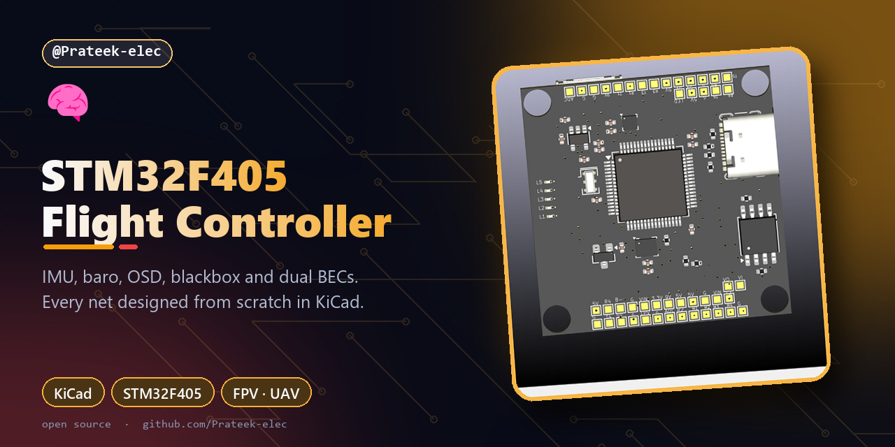

<div align="center">



**A full-featured FPV / UAV flight controller designed from scratch in KiCad 9: F405 MCU, ICM-42688-P IMU, BMP388 barometer, analog OSD, blackbox flash and two onboard switching BECs.**


</div>

---

## Highlights

- 🧠 **F405 brain + ICM-42688-P IMU:** the same class of hardware as commercial FPV boards.
- 📼 **OSD and blackbox on board:** MAX7456 video overlay and 16 MB of flight logging.
- ⚡ **Two switching BECs:** clean 5 V for the FC and a separate rail for video.
- 🔍 **Nothing hidden:** every net and footprint is open to study or fork.

## Why this board

Most hobby flight controllers are black boxes. This one is fully open: every net, footprint and power rail is in the KiCad source, so you can study how a modern F405-class FC is put together, or fork it into your own design.

## Hardware at a glance

| Block | Part | Notes |
|---|---|---|
| MCU | **STM32F405RGT6** | 168 MHz Cortex-M4F, the classic Betaflight / ArduPilot / INAV target class |
| IMU | **ICM-42688-P** | 6-axis gyro + accel on SPI |
| Barometer | **BMP388** | I²C, for altitude hold |
| Blackbox | **W25Q128** | 16 MB SPI flash for flight logs |
| OSD | **MAX7456** | Analog video overlay (video in / video out pads) |
| 5 V BEC | **TPS54302** buck | 5 V / 2 A rail for the FC, receiver and peripherals |
| VTX BEC | **TPS54302** buck | Separate switchable rail for the video transmitter / camera (9 V pads) |
| 3.3 V | **AP2112K-3.3** LDO | Clean rail for MCU and sensors |
| Protection | **AO3401A** P-MOSFET + fuse | Reverse-polarity protection on the battery input |
| USB | USB-C | Configuration and firmware flashing |
| Extras | Buzzer driver, status LEDs, boot button, battery voltage + current sense | |

### Connectivity

- **ESC connector**: battery, current sense, telemetry and 4× motor outputs (M1–M4)
- **HD VTX connector**: power + UART for digital video systems
- **Analog VTX / camera pads** routed through the MAX7456 OSD
- **Multiple UARTs** broken out for receiver, GPS, telemetry and VTX control
- I²C pads for an external compass or sensors

## Design files

<table>
<tr>
<td width="50%"><br/><sub><b>Schematic</b>: <code>hardware/kicad/fc002.kicad_sch</code></sub></td>
<td width="50%"><br/><sub><b>PCB layout</b>: <code>hardware/kicad/fc002.kicad_pcb</code></sub></td>
</tr>
</table>

## Open it yourself

1. Install [KiCad 9](https://www.kicad.org/download/).
2. Clone the repo:
   ```bash
   git clone https://github.com/Prateek-elec/custom-flight-controller-pcb.git
   ```
3. Open `hardware/kicad/fc002.kicad_pro`.
4. To manufacture, open the PCB editor and use **File → Fabrication Outputs → Gerbers** plus **Drill Files**.

## Repository layout

```text
hardware/kicad/   KiCad project (.kicad_pro / .kicad_sch / .kicad_pcb)
docs/images/      Schematic, layout and 3D renders used in this README
```

## Roadmap

- [x] Schematic
- [x] PCB layout and routing
- [ ] Fabrication outputs (Gerbers, BOM, pick-and-place) committed to the repo
- [ ] Board bring-up and test report
- [ ] Betaflight / ArduPilot target configuration
- [ ] Flight testing

## Contributing

Spotted a layout issue or want to suggest a part swap? [Open an issue](https://github.com/Prateek-elec/custom-flight-controller-pcb/issues). Reviews from other FC designers are very welcome.

## License

[MIT](LICENSE) © Prateek Sarkar

---

<div align="center">

### Found this useful?

**Drop a ⭐ so more builders find it, and share it with someone who'd build one.**

[](https://twitter.com/intent/tweet?text=A%20full%20STM32F405%20drone%20flight%20controller%2C%20open%20in%20KiCad%20%F0%9F%A7%A0&url=https%3A%2F%2Fgithub.com%2FPrateek-elec%2Fcustom-flight-controller-pcb)
[](https://www.linkedin.com/sharing/share-offsite/?url=https%3A%2F%2Fgithub.com%2FPrateek-elec%2Fcustom-flight-controller-pcb)
[](https://github.com/Prateek-elec)

</div>
